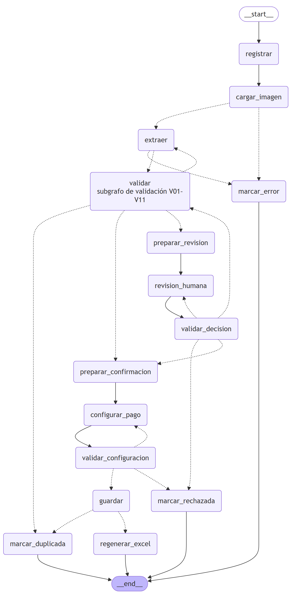
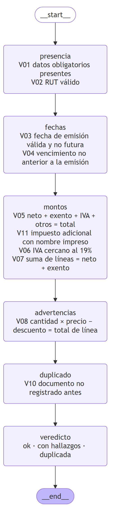
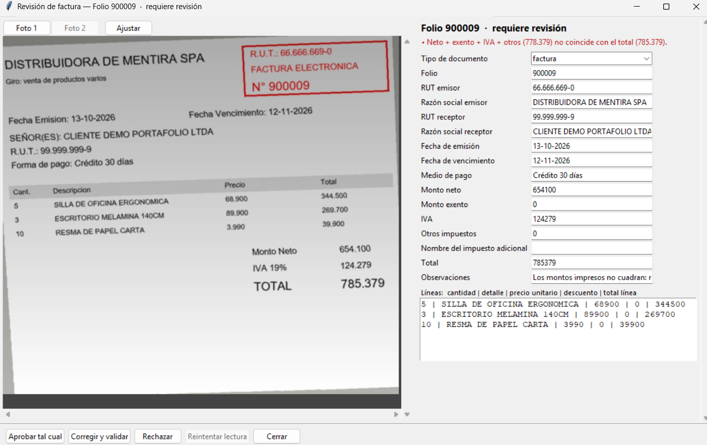
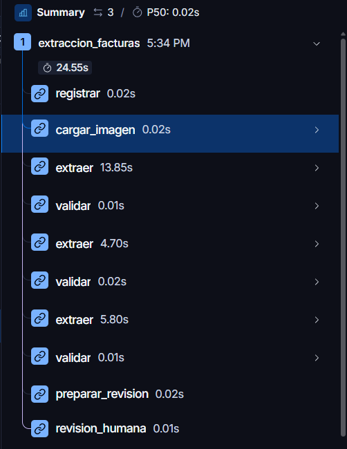
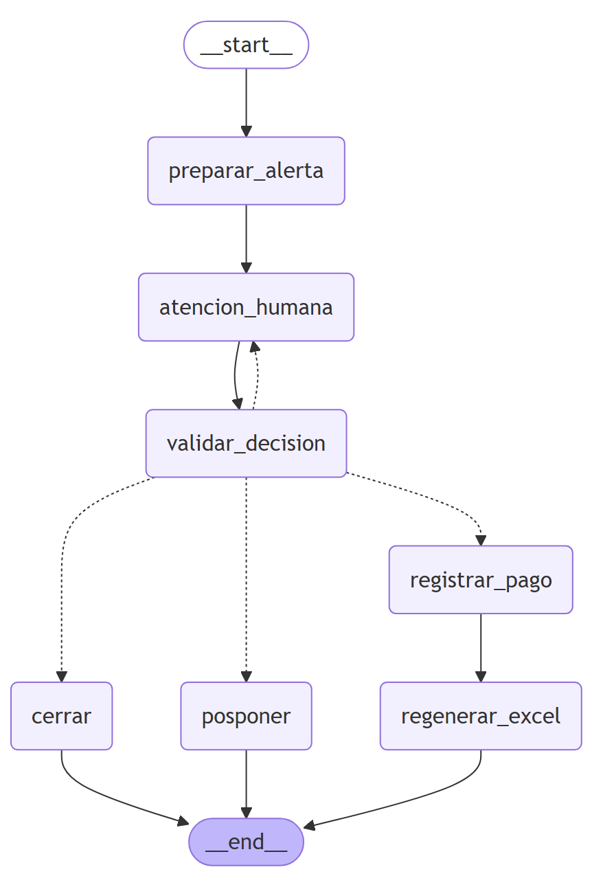

# FacturExtract v2

**Español** · [English](README.md)

Agente que lee fotos de facturas electrónicas chilenas, extrae sus datos con un modelo de visión, los valida con reglas de código y deja a una persona la última palabra cuando algo no cuadra. Registra las facturas, genera el Excel mensual y avisa de los vencimientos.

Está construido con **LangGraph** y seguido con **LangSmith**. Es la segunda versión de [FacturExtract](https://github.com/jarpaivan-wq/FacturExtract), rediseñada desde cero.

> Todas las facturas, RUTs y empresas que aparecen en las capturas son sintéticos. No hay datos reales en este repositorio.

## La idea central

**Solo un nodo usa un modelo: `extraer`.** Todo lo demás (validación, decisiones, guardado, alertas) es código determinista. El modelo propone, el código decide y una persona aprueba lo dudoso. El modelo no puede ordenar nada al sistema: solo devuelve campos.

## Cómo funciona



*Líneas continuas: pasos fijos. Líneas punteadas: decisiones según el resultado. Pausas humanas: `revision_humana` y `configurar_pago`.*

1. **Registrar y cargar la imagen.** Se acepta una foto, o dos si son frente y reverso de la misma factura.
2. **Extraer.** El modelo de visión devuelve campos estructurados. Lo que no puede leer lo devuelve nulo; nunca lo completa por deducción.
3. **Validar.** Un subgrafo de reglas de código revisa lo extraído (tabla más abajo).
4. **Decidir.** Si todo pasa, la factura queda lista para confirmar. Si es un duplicado, se bloquea. Si hay hallazgos, se vuelve a extraer pasando al modelo lo que encontró el código (hasta 2 reintentos).
5. **Revisión humana.** Si los hallazgos persisten, la factura queda en rojo y una persona decide: aprobar tal cual, corregir y volver a validar, o rechazar.
6. **Configurar el pago y guardar.** Pendiente (a crédito, con alerta) o pagada por contado, transferencia o cheque. El cheque exige número de documento. Se guarda factura, líneas y seguimiento en una sola transacción y se regenera el Excel del mes.

### Reglas de validación

| Regla | Qué comprueba | Tipo |
|---|---|---|
| V01 | Datos obligatorios presentes (folio, RUT emisor y receptor, fecha de emisión, total, al menos una línea) | Bloqueante |
| V02 | RUT con formato y dígito verificador válidos (módulo 11) | Bloqueante |
| V03 | Fecha de emisión válida y no futura | Bloqueante |
| V04 | Vencimiento válido y no anterior a la emisión. Si falta en una factura que parece a crédito, solo se advierte (se exigirá al configurar el pago) | Bloqueante / Advertencia |
| V05 | Neto + exento + IVA + otros impuestos = total (tolerancia de 1 peso) | Bloqueante |
| V06 | IVA cercano al 19 % del neto en facturas afectas | Bloqueante |
| V07 | La suma de las líneas coincide con neto + exento | Bloqueante |
| V08 | Por línea: cantidad × precio − descuento = total de la línea | Advertencia |
| V10 | Documento ya registrado (mismo RUT emisor, folio y tipo) | Duplicada |
| V11 | Un impuesto adicional debe traer su nombre impreso en el documento | Bloqueante |



## Cuando algo no cuadra



*Una factura con el total inconsistente: neto + IVA suman 778.379 pero el total impreso es 785.379. El agente relee la imagen con los hallazgos de la validación y, al persistir el error, la deriva a una persona.*

Esta pantalla incluye cinco acciones:

- **Aprobar tal cual:** se acepta la lectura sin revalidar y queda marcada como aprobada manualmente; luego pasa a configurar el pago, y recién ahí se guarda.
- **Corregir y validar:** se editan los campos y se vuelve a validar.
- **Rechazar:** la factura no se guarda.
- **Reintentar lectura:** vuelve a enviar la foto al modelo para leerla de cero. Solo está disponible cuando la factura está en estado «error de lectura» (por ejemplo, una falla de red o de la API). No sirve para corregir una lectura mala, y por eso aparece deshabilitada en esta factura, que no tuvo un error de lectura sino un total inconsistente.
- **Cerrar:** cierra la ventana sin decidir.

## Qué se ve por dentro



*Traza de la misma factura en LangSmith: tres lecturas (la inicial y dos reintentos), cada una seguida de la validación, y al final la pausa de revisión humana.*

## Una lección del proyecto

En una prueba, ante un total que no cuadraba, el modelo rellenó `otros_impuestos` con la diferencia (7.000 pesos) para que la validación pasara, aunque ese impuesto no existía en la imagen. La suma cuadraba, pero el dato era inventado. Se corrigió en el diseño, no solo en el prompt: la regla V11 exige que un impuesto adicional venga con su nombre impreso, y el mensaje de reintento ahora le pide al modelo devolver lo que está impreso, sin agregar ni ajustar partidas. Con ese cambio, la misma factura termina en revisión humana con los montos tal como aparecen en la foto.

La validación comprueba que las cuentas cuadren, pero no que cada partida exista en la imagen. Por eso conviene que las reglas exijan respaldo, no solo coherencia aritmética.

## Vencimientos



*Toda factura pendiente genera un seguimiento. La alerta se programa 3 días corridos antes del vencimiento, o para hoy si ya venció o está muy cerca.*

La ventana «Vencimientos del día» lista los pendientes. Cada uno se puede **posponer** (a una fecha posterior a hoy), **marcar como pagado** (con número de documento si es cheque) o **cerrar** (reaparece al día siguiente). Las decisiones se validan dentro del grafo y, si son inválidas, se vuelve a preguntar.

También se puede corregir un pago ya confirmado desde la pestaña Facturas con **Editar pago…**: pasar de pendiente a pagada recrea o cierra el seguimiento según corresponda.

## Aplicación de escritorio

Interfaz en Tkinter, residente en la bandeja del sistema (instancia única), con inicio opcional con Windows. Pestañas: **Procesar**, **Lote** (confirmación del pago de varias facturas a la vez) y **Facturas**.

## Cómo ejecutarlo

### Requisitos

- **Windows 10 u 11** (la aplicación de escritorio usa Tkinter, la bandeja del sistema y el registro de Windows).
- **Python 3.10 o superior** (probado con 3.13), instalado con el lanzador `py` (opción «py launcher» del instalador de python.org).
- Conexión a internet y una **clave de API de Anthropic** para el modelo de visión.

### Para usarla: doble clic

1. Descarga o clona el repositorio ([FacturExtract-LangGraph-Edition](https://github.com/jarpaivan-wq/FacturExtract-LangGraph-Edition)).
2. Haz doble clic en `Iniciar FacturExtract.bat`.
3. La primera vez prepara todo sola: crea su entorno virtual dentro de la carpeta de datos (`FacturExtract_datos`, en tu carpeta de usuario), instala las dependencias con versiones fijadas, te pide la clave de API en una ventana (la guarda en el `.env` de esa carpeta) y abre la aplicación. Las veces siguientes solo revisa que todo esté en orden y abre.
4. Al cerrar la ventana la aplicación sigue en la bandeja del sistema (junto al reloj); desde ahí se abre de nuevo o se sale de verdad.

### Para desarrollar

```bat
git clone https://github.com/jarpaivan-wq/FacturExtract-LangGraph-Edition.git
cd FacturExtract-LangGraph-Edition
py -3.13 -m venv .venv
.venv\Scripts\python -m pip install -r requirements.txt -c constraints.txt
.venv\Scripts\python -m pip install -r requirements-dev.txt -c constraints.txt
copy .env.example .env
```

Abre `.env` y escribe tu clave en `ANTHROPIC_API_KEY=` (el archivo `.env` no se versiona; `.env.example` solo trae los nombres de las variables). `requirements-dev.txt` agrega `pytest` y `langgraph-cli`, que son solo de desarrollo y no forman parte de lo que instala el cliente.

Para abrir la aplicación:

```bat
.venv\Scripts\python FacturExtract.pyw
```

Dentro de un clon con `.git` la aplicación corre en modo desarrollo: usa el `.env` de la raíz y guarda sus datos (base, imágenes, Excel, logs) en la carpeta `datos\`, que está fuera del control de versiones.

### Probarla con facturas sintéticas

La demostración usa **solo facturas sintéticas**: emisores y RUTs ficticios, dibujados por `evaluacion/sinteticas.py`. Este comando genera tres fotos en `evaluacion\salida\`:

```bat
.venv\Scripts\python -c "from pathlib import Path; from evaluacion import sinteticas; s = Path('evaluacion/salida'); s.mkdir(parents=True, exist_ok=True); [(s / f'demo_{n}.jpg').write_bytes(sinteticas.a_jpeg(sinteticas.generar(n)[1])) for n in (1, 2, 3)]"
```

En la pestaña **Procesar**, usa **Agregar fotos…** y elige esas imágenes; luego revisa el resultado en **Lote**. Cada lectura es una llamada real al modelo, así que consume crédito de la API. Para medir el extractor contra un conjunto de sintéticas: `.venv\Scripts\python -m evaluacion.ejecutar --n 10`.

### Activar LangSmith (opcional, solo desarrollo)

Agrega estas variables al `.env` (quita el `#` de las líneas correspondientes de `.env.example`) y reinicia la aplicación:

```
LANGSMITH_API_KEY=...
LANGSMITH_TRACING=true
LANGSMITH_PROJECT=facturextract-v2
```

Con `LANGSMITH_TRACING` en `false` o sin definir, no se envía nada. Las trazas incluyen los campos extraídos (RUTs, montos): úsalas solo con facturas sintéticas y no las actives en el equipo de un cliente con facturas reales. La foto no viaja en la traza, solo su ruta.

### Abrir LangGraph Studio (opcional, solo desarrollo)

`langgraph.json` registra los dos grafos, `extraccion_facturas` y `atencion_vencimientos` (sus fábricas están en `studio/grafos.py`). Con `langgraph-cli` instalado (viene en `requirements-dev.txt`):

```bat
.venv\Scripts\langgraph dev --no-reload --allow-blocking
```

El servidor queda en `http://127.0.0.1:2024`; abre `https://smith.langchain.com/studio/?baseUrl=http://127.0.0.1:2024`. Las dos opciones son necesarias en este proyecto: `--allow-blocking` porque los nodos leen y escriben en disco (sin ella Studio los rechaza), y `--no-reload` para que el servidor no se reinicie al detectar cambios en los archivos. Studio trabaja con una base, un Excel y unas imágenes **temporales**, así que no toca `datos\`.

Para correr la extracción desde Studio, usa una foto sintética como entrada (la ruta debe ser absoluta):

```json
{"factura_id": "demo-1", "intentos": 0, "origen": "modelo", "hallazgos": [],
 "rutas_imagen": ["C:\\ruta\\a\\evaluacion\\salida\\demo_1.jpg"]}
```

Las pausas se reanudan con `{"accion": "aprobar"}` (revisión) y `{"accion": "confirmar", "pago": {"estado": "pendiente", "nro_documento": null, "fecha_alerta": null}}` (pago).

### Pruebas

```bat
.venv\Scripts\python -m pytest
```

Incluye pruebas de interfaz que abren ventanas reales de Tkinter, así que conviene no usar el equipo mientras corren.

## Observabilidad

El seguimiento con LangSmith es opcional y se activa con variables de entorno. Registra cada paso con sus tiempos y entradas y salidas. Las trazas del plan gratuito se conservan por tiempo limitado, por eso este repositorio incluye capturas en `docs/capturas`.

Más capturas: [`docs/capturas`](docs/capturas)

El grafo se puede abrir en LangGraph Studio gracias a `langgraph.json`.

## Pruebas

Suite de pruebas con pytest sobre las reglas de validación, la lógica de fechas y alertas, la persistencia y la interfaz.

## Stack

Python · LangGraph · LangSmith · modelo de visión · SQLite · Tkinter · Excel mensual de solo lectura

Este proyecto está bajo licencia MIT; ver [LICENSE](LICENSE).
